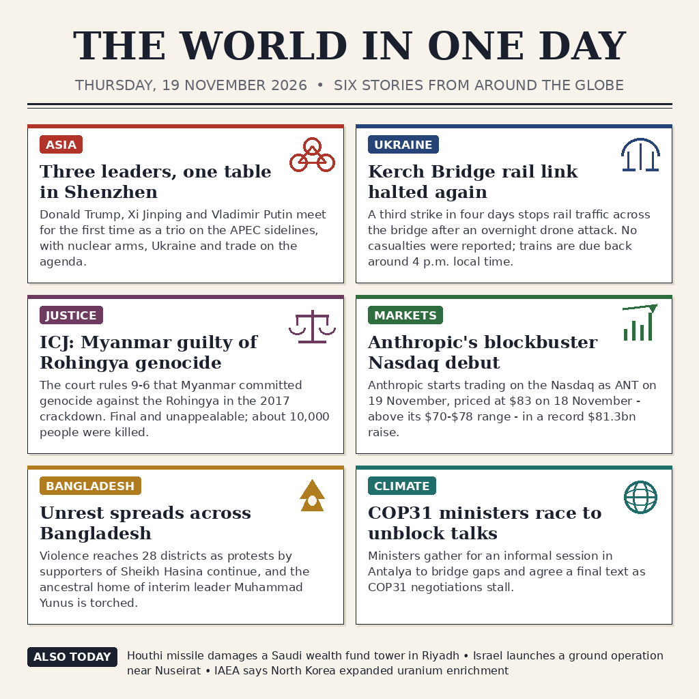

# The World in One Day — 19 November 2026

[](https://make.fun/bounty/news-image-20261119)
[](https://make.fun/bounty/news-image-20261119)
[](https://make.fun/bounty/news-image-20261119)

One image that sums up the world's news of **Thursday 19 November 2026** — built for the [make.fun bounty](https://make.fun/bounty/news-image-20261119) (referral code: `mcpf7r82`).



## The day in six stories

1. **Asia** — Donald Trump, Xi Jinping and Vladimir Putin held their first three-way summit in Shenzhen, on the sidelines of APEC, to talk nuclear arms, Ukraine and trade.
2. **Ukraine** — A third Ukrainian strike in four days halted rail traffic on the Kerch Bridge to Crimea; Russia said no one was hurt and trains were due back by 4 p.m.
3. **Justice** — The International Court of Justice ruled 9–6 that Myanmar committed genocide against the Rohingya in its 2017 crackdown; the final judgment cannot be appealed.
4. **Markets** — Anthropic's shares began trading on Nasdaq as ANT after a record $81.3bn offering priced at $83, above its $70–$78 range.
5. **Bangladesh** — Unrest spread to 28 districts as the ancestral home of interim leader Muhammad Yunus was set ablaze amid protests by supporters of Sheikh Hasina.
6. **Climate** — COP31 ministers met in informal session in Antalya to bridge gaps and agree a final text before the summit closes.

Also today: a Houthi missile damaged the Saudi wealth fund tower in Riyadh; Israel launched a ground operation near Nuseirat; the IAEA said North Korea expanded uranium enrichment.

## How it works

`gen_image.py` draws the front page (1024×1024 PNG) with Pillow from the stories above — a masthead naming the date, six cards with a headline, a short factual summary and a pictogram, and a footer ticker. `main.ts` (Node 22, standard library only) copies `entry.png` to the grader's output directory, since the program runs with no network:

```sh
mkdir -p out && MAKEFUN_OUTPUT_DIR=out node main.ts
```

## License

MIT — see [LICENSE](LICENSE).
